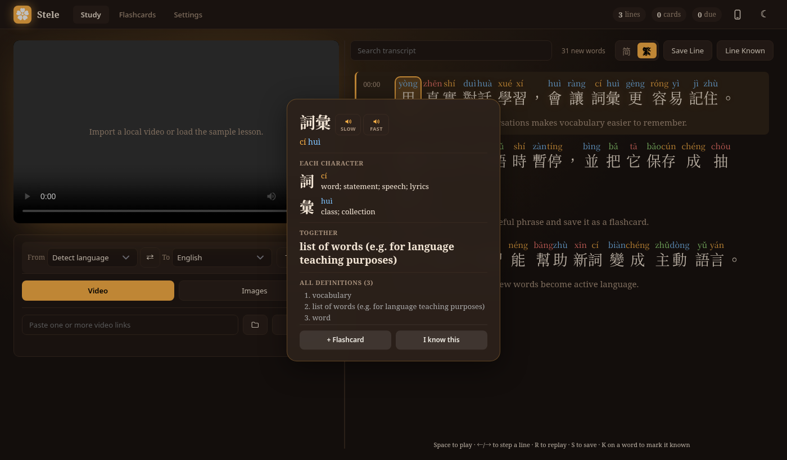

# Stele

**Learn a language from real videos.** Paste a link (or pick a video file) and
Stele gives you the subtitles with a translation under every line, pinyin over
every Chinese character, and a word you can click to see what it means *in
that sentence*. Save the words you want to keep as flashcards, and Stele
reviews them with you until you can read them, write them and hear them.

Everything runs on your own computer: transcription, translation and your
cards stay there.



**Study languages:** Chinese, English, Spanish, Portuguese, French and German.
Videos are translated into English by default (English videos into Chinese),
or into the language you pick. A video in any other language is refused with
a message saying so. More are added one at a time, each after its
translation, transcription and OCR have been checked; see
[docs/adding-a-language.md](docs/adding-a-language.md).

**On your phone:** open
[k1ngsalm0n.github.io/subtitles-and-learning-app](https://k1ngsalm0n.github.io/subtitles-and-learning-app/)
and add it to your home screen. The phone edition needs no computer: choose a
video on your phone, and Stele writes its subtitles, translates them and
explains each word you tap, using a free [Groq](https://console.groq.com/keys)
key of your own, which stays in your phone's browser. It doesn't import
YouTube links or read screenshots (those need the computer). Your cards live
on the phone; to move them between your phone and a computer, use **Settings →
Your data → Export** on one and **Import** on the other.

**New to all this?** [docs/getting-started.md](docs/getting-started.md) walks
through installing and using Stele step by step, with no terminal experience
assumed.

## What it does

**Getting a video in**
- Paste one or several links (YouTube, Bilibili, Vimeo, news sites and most
  sites [yt-dlp](https://github.com/yt-dlp/yt-dlp) supports), or choose a video
  or audio file from your computer. They import one at a time in the
  background, and every finished video is kept in your Videos list.
- The uploader's own subtitles are used when there are any. Otherwise the
  speech is transcribed with Whisper, and captions burned into the picture are
  read off the frames.
- With a chat model set up, misheard words are fixed before translating
  (果 "fruit" for 國 "country", same sound), and lines are translated with
  their neighbours as context. Without one, an offline translator does it.

**Studying a video**
- A transcript that follows the video, with the translation under each line.
- Pinyin over every character, coloured by tone; a switch between Traditional
  and Simplified.
- Click a word: its reading, each character and what it contributes, the
  meaning, what it means in this line, and every dictionary definition. Hear
  it fast or slow.
- "N new words" lists the video's words you haven't met yet, the most
  repeated first. Mark the ones you already know and they fade in every
  transcript.
- Keyboard first: Space plays, ← / → step between lines, R replays a line,
  S saves it, K marks a word as known.

**Flashcards**
- A card shows the word in the sentence you met it in, with a button that
  replays that moment of the video.
- Cards grow with you: first you recognise the word, then you write it from a
  new sentence, then you write it from hearing the sentence.
- Spaced repetition decides when each card comes back. Decks, card templates,
  fill-in-the-blank cards, stroke-order animation and stroke-by-stroke drawing
  practice for characters.
- Export to JSON or to Anki.

**Around it**
- Word explanations from your Claude subscription, a free Groq key, Gemini,
  OpenRouter, OpenAI, DeepSeek, Ollama on your own computer, or none at all.
  With Claude, each new video is prepared in the background: hard words
  explained, stiff translations smoothed.
- Automatic backups of your cards on your computer.
- Use it on your phone through [Tailscale](https://tailscale.com); cards sync
  between the two.
- Settings → What's running shows every part of Stele: what works, what's
  using a fallback, and the command that fixes it.
- A warm dark look by default ("Lantern"), a light mode, and six accent
  colours.

## Run

```bash
npm start
```

Then open `http://localhost:3000`.

### System tools

`ffmpeg` is needed to mux downloaded streams and feed audio to Whisper. Install
it with your distro's package manager (`pacman`, `dnf`, `apt`, `brew`, …), e.g.:

```bash
sudo pacman -S --needed ffmpeg   # or: dnf install ffmpeg / apt install ffmpeg
```

### Python environment (transcription + translation + OCR + URL import)

The local transcription (Whisper), translation (Marian Opus-MT / NLLB-200),
burned-in caption OCR (RapidOCR), and URL import (yt-dlp) steps run through
Python. This project uses [uv](https://docs.astral.sh/uv/);
the pinned ML dependencies live in `pyproject.toml` / `uv.lock`. The easiest
setup is one command:

```bash
npm run sync
```

This runs `uv sync`, installs nightly yt-dlp, drops a static
[deno](https://deno.land/) binary into the venv (yt-dlp's JavaScript runtime —
without one, YouTube extraction degrades to ~144p), installs the best-fit CUDA
torch wheel for your GPU (via `nvidia-smi`, or stays on CPU if there's no usable
NVIDIA card), and prefetches the translation + Whisper models so the first run
doesn't stall on a multi-GB download. It's re-runnable; force a torch build with
`CUDA_BUILD=cpu` or `CUDA_BUILD=cu130`, or skip the model download with
`SKIP_MODELS=1`.

<details>
<summary>What it does, step by step (run manually if you prefer)</summary>

```bash
uv sync                                                  # creates .venv from the lock (CPU torch)
uv pip install -U --prerelease=allow "yt-dlp[default]"   # nightly; URL import
```

`uv sync` installs torch, which is large. yt-dlp is installed separately because
it's kept on the nightly channel (the stable release lags behind YouTube's
frequent changes), so it's deliberately not pinned in the lockfile.

torch is locked to the **CPU** build so it runs on any machine. To use an NVIDIA
GPU, install a matching CUDA wheel over the top (Whisper/NLLB auto-detect it):

```bash
# e.g. GTX 10-series (sm_61) — the cu126 wheel JITs correctly; the default
# cu130 wheel drops older GPUs. Pick the CUDA build that fits your card.
uv pip install --reinstall-package torch torch==2.12.1 \
  --index https://download.pytorch.org/whl/cu126 --index-strategy unsafe-best-match
```
</details>

<details>
<summary>Without uv (plain venv + pip)</summary>

```bash
python -m venv .venv
source .venv/bin/activate
pip install -e .                                   # reads pyproject.toml
pip install -U --pre "yt-dlp[default]"
```
</details>

> **First run downloads models.** If you skipped `npm run sync`'s prefetch, the
> first translation/transcription downloads them instead: Marian Opus-MT
> (~310 MB per direction) for zh↔en, `facebook/nllb-200-distilled-600M`
> (~2.4 GB) as the fallback for other pairs, plus a Whisper speech model — all
> cached under `~/.cache/huggingface`. The app appears to pause while it happens.

### Translation

Translation is fully offline and routed per language pair: **Marian Opus-MT**
(`Helsinki-NLP/opus-mt-zh-en` / `opus-mt-en-zh`, fast even on CPU) handles the
app's zh↔en pairs, with **NLLB-200** as the fallback for everything else.

### Transcription and burned-in captions

When a video has no subtitle track, the audio is transcribed locally with
OpenAI Whisper. Low-confidence garbled speech is shown as *(indistinct voice)*
instead of nonsense text. Audio in a language Stele can't study yet (see the
note at the top) is refused with a clear message instead of being transcribed.

URL imports with no subtitle track also get an automatic **burned-in caption
OCR** pass (RapidOCR): a quick frame probe skips videos with no on-screen text,
otherwise hardcoded captions are read off the frames and merged with Whisper
speech where the captions leave gaps.

Chinese subtitles are normalised to **Traditional characters** (OpenCC) by
default; set `ZH_SCRIPT=off` in `.env` to keep each source's original script.

### Pronunciation and word lookups

A romanization line is shown above the source subtitles — pinyin for Chinese,
romaji for Japanese, transliteration for other non-Latin scripts.

Clicking a word asks a chat model for an explanation: your Claude
subscription, or any OpenAI-compatible API (a free Groq key or local Ollama
both work). Choose one in the dialog that opens on first visit, or later in
Settings → What's running; the `LLM_*` settings in `.env.example` do the same.
Chinese words also get CC-CEDICT's readings and a breakdown by character, and
the other study languages a Wiktionary dictionary. With no chat model, meanings
come from the dictionaries and the offline translator.

### Configuration

Copy the example config and adjust as needed:

```bash
cp .env.example .env
```

Notable settings (all documented in `.env.example`): `WHISPER_MODEL` (defaults
to `auto`, which sizes the model to your machine — note `base`/`tiny`
hallucinate badly on Chinese), `WHISPER_DEVICE` / `TRANSLATE_DEVICE`, the
`LLM_*` word-lookup provider, and `ZH_SCRIPT`.

## Tests

Unit tests cover subtitle parsing, caption merging, language routing,
romanization, OCR filtering, and the lookup/translate helpers.

JavaScript (via `node --test`):

```bash
npm test
```

Python, from the activated venv:

```bash
python -m unittest discover -s test -p "test_*.py"
```

## License

Copyright (C) 2026 k1ngsalm0n.

Stele is free software under the
[GNU Affero General Public License v3.0](LICENSE) or later. You may use,
study, change and share it. If you share a changed version, or run one for
other people over a network, you must keep this notice and publish your
changes under the same license.

The data listed under Attribution below keeps its own license.

## Attribution

Chinese word meanings and readings come from
[CC-BY-SA CC-CEDICT](https://www.mdbg.net/chinese/dictionary?page=cc-cedict)
(`data/cedict-seed.u8`, a small committed excerpt, and `data/cedict.u8`,
downloaded by `npm run sync`, not committed), licensed
[CC BY-SA 4.0](https://creativecommons.org/licenses/by-sa/4.0/).

Stroke-order data comes from
[Make Me a Hanzi](https://github.com/skishore/makemeahanzi)
(`data/graphics.txt`, downloaded by `npm run sync`, not committed). Its
graphics derive from Arphic Technology fonts released under the
[Arphic Public License](https://github.com/skishore/makemeahanzi/blob/master/APL.txt).

Word meanings for study languages other than Chinese come from
[Wiktionary](https://en.wiktionary.org/), via the machine-readable extracts
at [kaikki.org](https://kaikki.org/) (Tatu Ylonen, *Wiktextract*, LREC 2022)
(`data/wiktionary-<code>.tsv`, downloaded by `npm run sync`, not committed).
Wiktionary's text is licensed
[CC BY-SA 4.0](https://creativecommons.org/licenses/by-sa/4.0/) and GFDL.

## Your data, and where it sits

Everything stays on this machine. Nothing is uploaded, with one exception you
control: word lookups and line translation call a chat model only when you choose
one (in the app, or in `.env`), and Settings → What's running lets you turn that off and shows
which path is actually in use.

Two things are worth knowing about:

- **Cookies for URL import are stored unencrypted.** Pasting cookies in
  Settings → Importing video writes them verbatim to
  `~/.local/share/stele/cookies.txt` (Netscape format, the file yt-dlp reads),
  with the chosen mode in `cookies.json` beside it. Both are readable only by
  your user (0600), they sit outside the checkout so they can't be committed,
  and the app never sends them back to the page — Settings only says how many
  are saved. There is still no encryption and no OS keychain involved: any
  process running as you can read them, and a backup of your home folder takes
  them along. These are live session cookies — whoever holds them can act as
  you on that site until they expire, without your password and usually without
  tripping two-factor.

  The "Browser" mode is the safer option where it works: it points yt-dlp at
  your browser's own profile instead, so no copy is made here. To get rid of a
  pasted set, use "Remove saved cookies" in Settings, or delete
  `~/.local/share/stele/cookies.txt`.

- **yt-dlp updates itself.** YouTube starts refusing an old yt-dlp within
  weeks, so the server checks the copy in `.venv` 30 seconds after starting
  and then daily, and once it's a week old installs the newest nightly from
  PyPI between imports. That means new code from the yt-dlp project runs on
  your machine without you being asked. To decide for yourself instead, set
  `STELE_YTDLP_AUTOUPDATE=off` in `.env` and update with
  `uv pip install -U --prerelease=allow "yt-dlp[default]"` when imports start
  failing. A yt-dlp on your PATH is never touched.

- **Flashcards live in the browser's localStorage**, which a "clear site data",
  a private window, or a changed port will wipe. That is what the backups in
  `~/.local/share/stele/backups` are for — see Settings → Automatic backups.

## Notes

- Audio is offered at two speeds wherever a word appears — the transcript
  pop-up and both faces of a flashcard. Three engines, best first: **piper**
  (a neural voice, `VOICES=1 npm run sync`), the browser's own
  `speechSynthesis`, then **espeak-ng**. Audio is never hidden: the server can
  always speak, which it could not when this app relied on browser voices
  alone. Settings → What's running says which engine you are actually hearing.
- The app does not bypass access controls. Keep URL ingestion limited to content you own, created, or are otherwise authorized to process.
